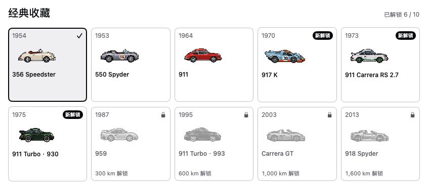
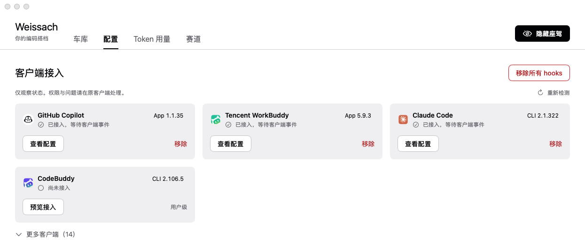
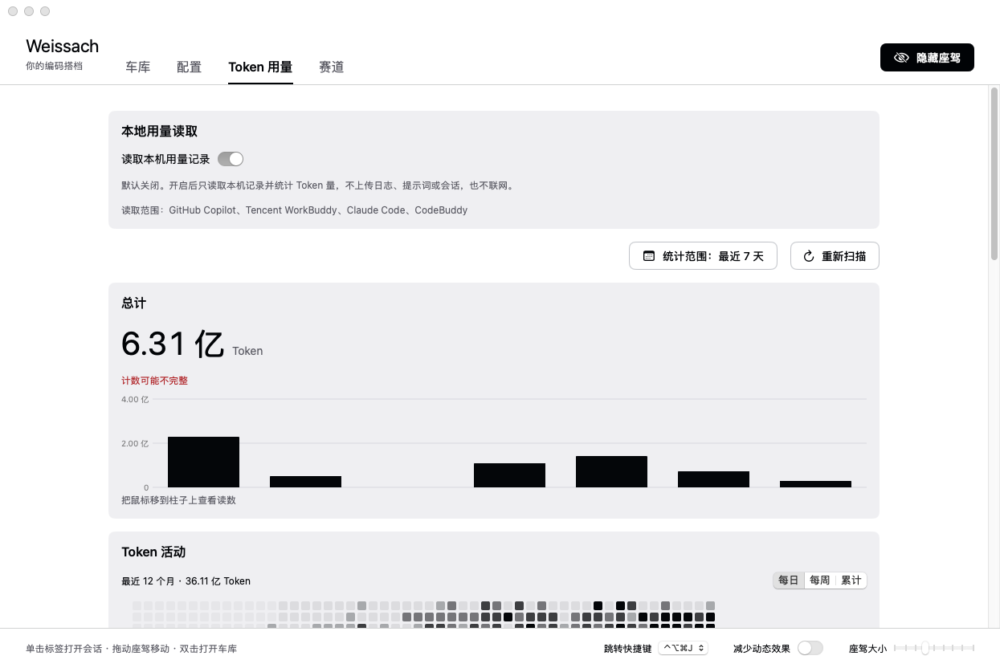
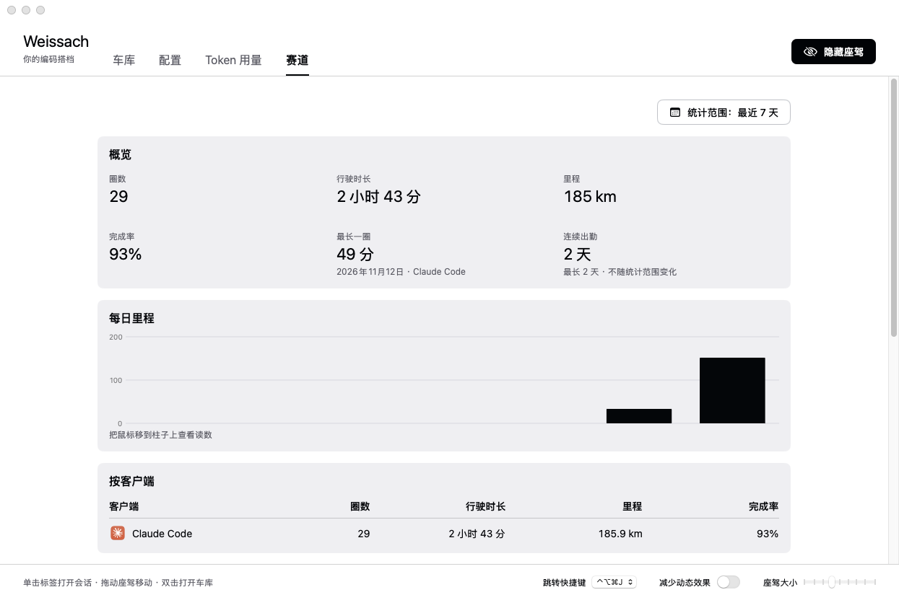

# Weissach

Weissach 以保时捷研发中心命名，是一个独立悬浮在 macOS 桌面的编码搭档。十款原创像素车型，用五种动画状态陪伴编码。主窗口分为四个 tab：**车库**（车型、演示、实时会话）、**配置**（客户端接入）、**Token 用量**（本机用量统计）、**赛道**（圈数、里程与出勤统计）。

支持 18 个客户端：Claude Code、Codex、GitHub Copilot、Cursor、Gemini CLI、Antigravity CLI、CodeBuddy、Tencent WorkBuddy、Qoder、Qoder CN、QoderWork、Qwen Code、Kimi CLI、OpenCode、Pi Agent、Oh My Pi、Hermes、OpenClaw。Weissach 只观察会话状态，所有权限确认和问题仍由原客户端处理。

## 截图

<p align="center"></p>

**车库**：十款车型，随里程逐步解锁。



**配置**：检测本机已安装的客户端，逐个接入或移除。



**Token 用量**：只读取本机记录，按天统计。



**赛道**：圈数、行驶时长、里程与出勤。



## 下载

**[下载 Weissach-1.2.0-mac-universal.dmg](https://github.com/qubyyang/Weissach-Release/releases/latest/download/Weissach-1.2.0-mac-universal.dmg)**

历史版本见 [Releases](https://github.com/qubyyang/Weissach-Release/releases)。

- 系统要求：macOS 14 或更新版本
- 架构：Universal（Apple Silicon 与 Intel）
- 安装包已用 Developer ID 签名并通过 Apple 公证，可以直接打开

## 安装

1. 打开 DMG，把 `Weissach.app` 拖入 `/Applications`。
2. 启动 Weissach，在「配置」tab 里为要接入的客户端点「查看配置 → 备份并安装」。

建议先把 App 移入 `/Applications` 再配置接入，这样写入各客户端的命令路径不会随 App 位置变化。

## 校验

```sh
shasum -a 256 Weissach-1.2.0-mac-universal.dmg
```

1.2.0 的 SHA-256：

```
107e405ba483d4dcf0578eb42b0a20f2407d7fd7bcac2ac1dc9b734041e99154
```

## 使用

- 拖动座驾改变位置，双击打开车库，右键切换车型、演示状态或隐藏座驾。
- 菜单栏汽车图标可打开车库、显示或隐藏座驾、退出；有会话待回应或中断时，图标旁会出现色点和数量，有会话跑完还没看时另有一个绿点。
- 等你回应、中断或跑完的会话会一直显示，并标出已经等了多久，直到你处理它或它确实结束；关掉终端标签页或结束会话后，它会在约 10 秒内消失。
- 全局快捷键「跳到待处理会话」默认 `⌃⌥⌘J`，可在主窗口底栏修改或关闭。通过 Weissach 跳转到一个会话即视为已看；也可以在菜单栏或座驾的右键菜单里选择「全部标为已看」。
- 有新版本时，主窗口底栏和菜单栏菜单里会出现「有新版本 → 下载」，点击打开下载页。Weissach 不会自己下载或安装。

## 数据

数据保存在本机 `~/Library/Application Support/Weissach`。卸载时删除 App 和这个目录即可。

检查更新是 Weissach 唯一的联网行为：启动时和每天一次，向 GitHub 读取最新版本号。请求不含任何本机信息；GitHub 会看到这台电脑的 IP 地址和 Weissach 的版本号。在「配置」tab 关闭「自动检查更新」后不再发出任何请求。

## 反馈

问题和建议请提交到 [Issues](https://github.com/qubyyang/Weissach-Release/issues)。
